# NoteLy

NoteLy is a native iOS notes app with a private vault. Everyday notes are a normal notes app: create, edit, search, pin, and color-tag. Private notes are encrypted on the device and do not appear in the notes list. They open only when you submit a secret phrase in Search and then pass Face ID or the device passcode.

The vault is disclosed in onboarding, in Settings, and in the App Review notes. There is no button that opens it. The phrase is the secret, not the existence of the feature.

## Guide

Screens below are from the iPhone app.

### First launch

Get Started, then a phrase you type twice, a 6-digit code, and optional Face ID. The phrase screen shows an example, bright-harbor, so Continue is ready. That example is not a phrase saved on a phone.

| Welcome | Your phrase |
| --- | --- |
| 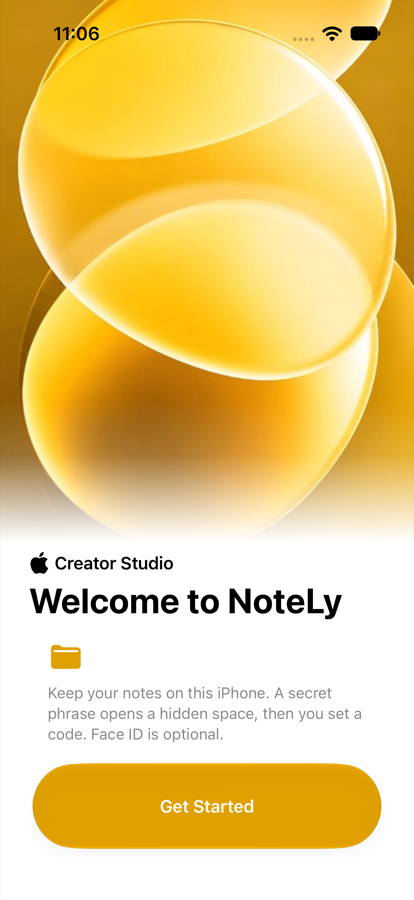 | 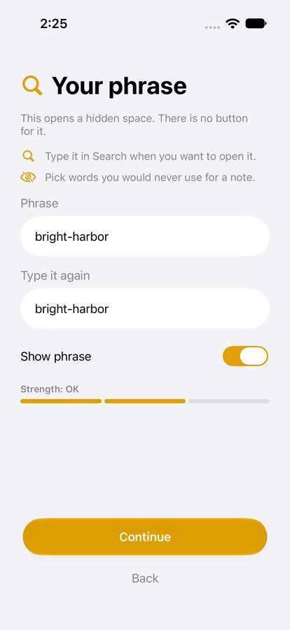 |

| 6-digit code | Face ID |
| --- | --- |
| 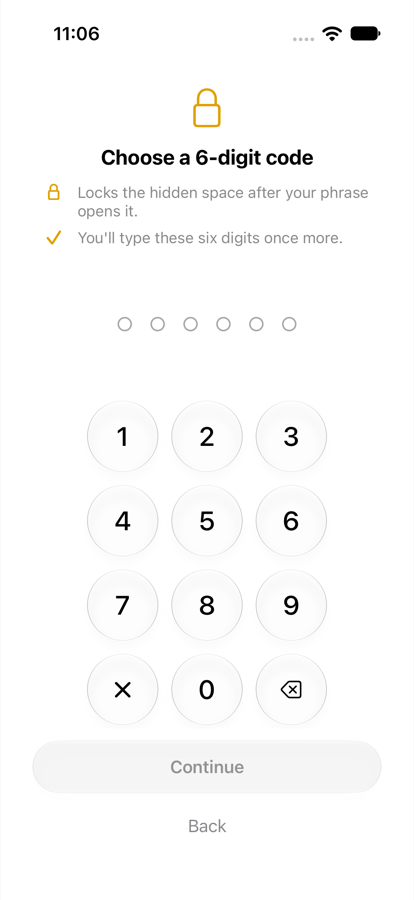 | 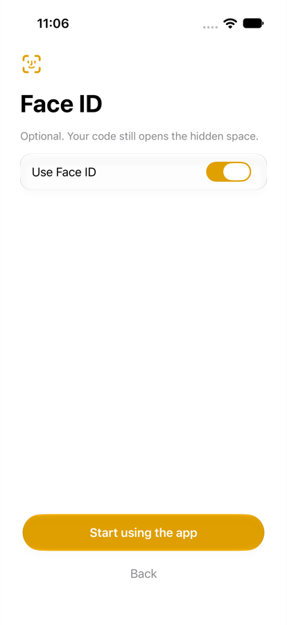 |

### Notes

Folders hold everyday notes. The sample has three notes in Notes, two in Personal, and two in Work. Search and the new-note button sit at the bottom. Settings is the gear.

| Folders | Settings |
| --- | --- |
| 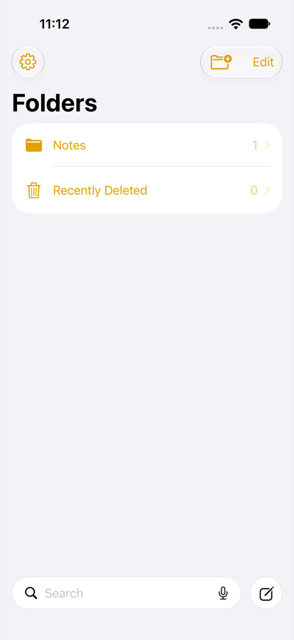 | 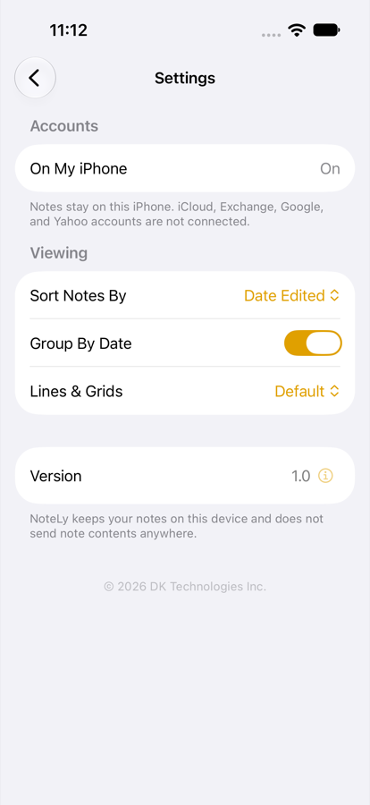 |

| Notes | A note |
| --- | --- |
| 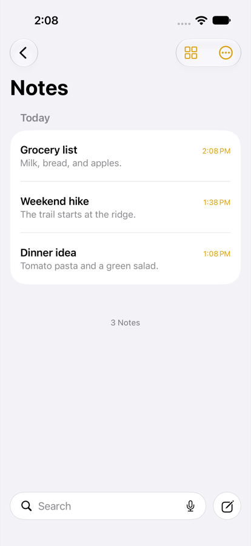 | 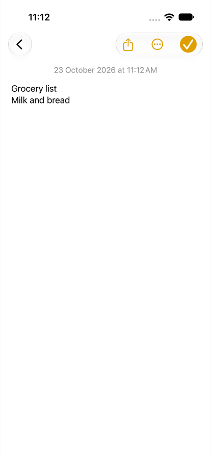 |

### Hidden space

Type the phrase into Search and submit it, then confirm with Face ID or the 6-digit code. The hidden folders use a red accent. Lock is the button at the top left. The sample has seven private notes. Files keeps photos, videos, and documents on this iPhone, with filters for all, photos, videos, and files.

| Hidden Folders | Private notes |
| --- | --- |
| 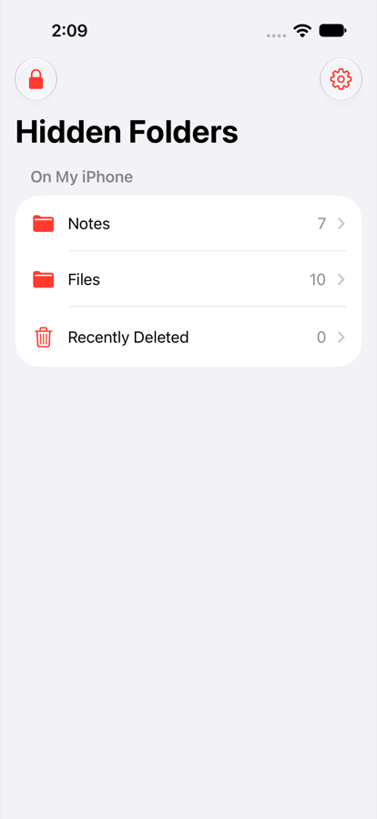 | 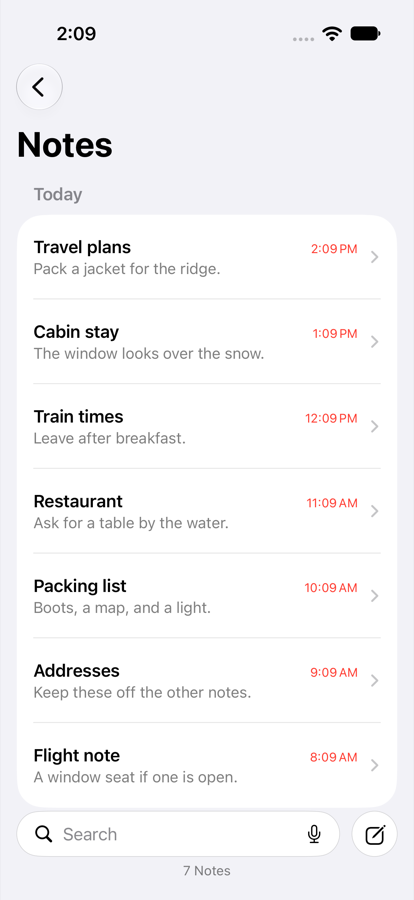 |

| A private note | Files |
| --- | --- |
| 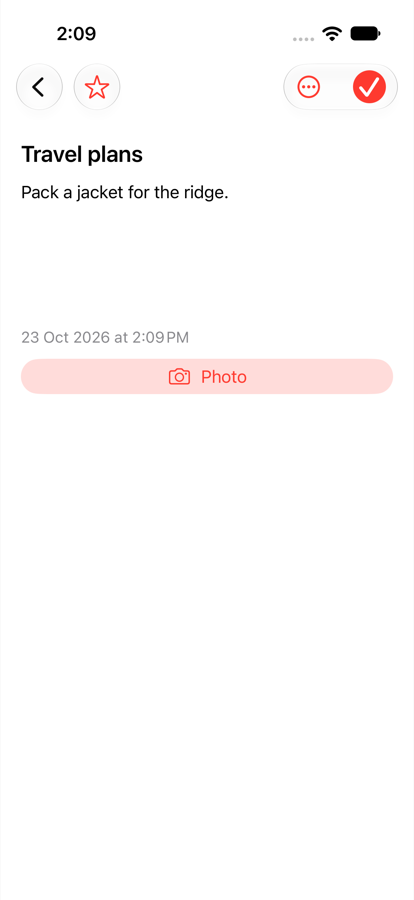 | 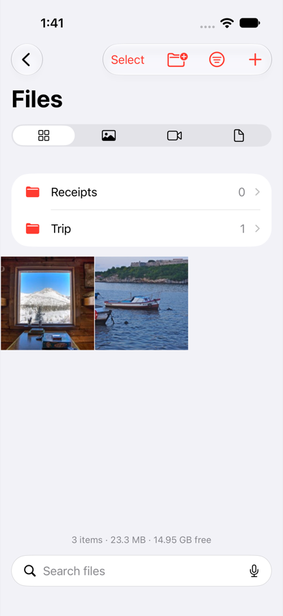 |

All shows folders and photos together. Photos, Videos, and Files show matching items from every folder and hide the folder list. There are ten real photos, about 6,000 to 6,700 pixels wide. Coast and Mountains each hold two. Trip holds a meadow, a forest, and a sunset. Harbor, the cabin window, and the bridge stay in Files.

| Inside Trip | Add: Move or Copy |
| --- | --- |
| 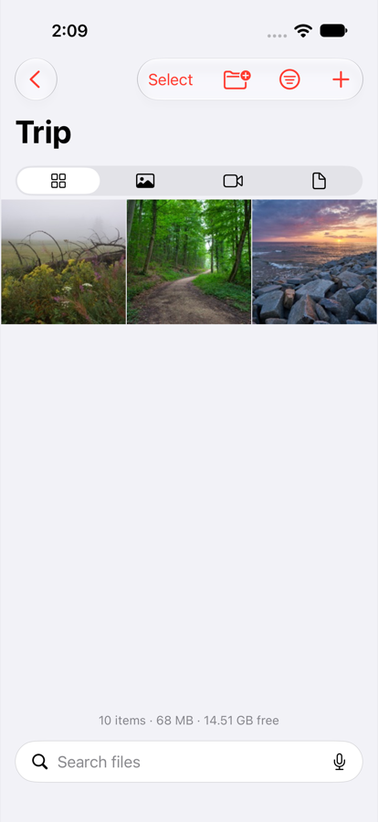 | 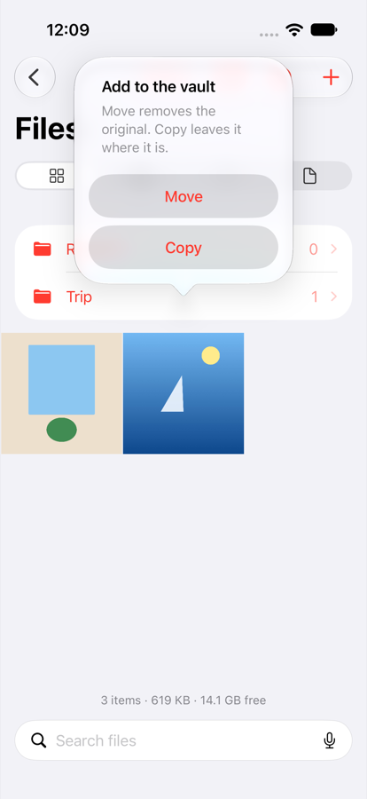 |

Tap + and choose Photos or Videos, Files, or Camera. **Move** removes the original after the file is saved here. **Copy** leaves the original where it is.

Press and hold a photo to lift it and open its menu.

| Press and hold a photo |
| --- |
| 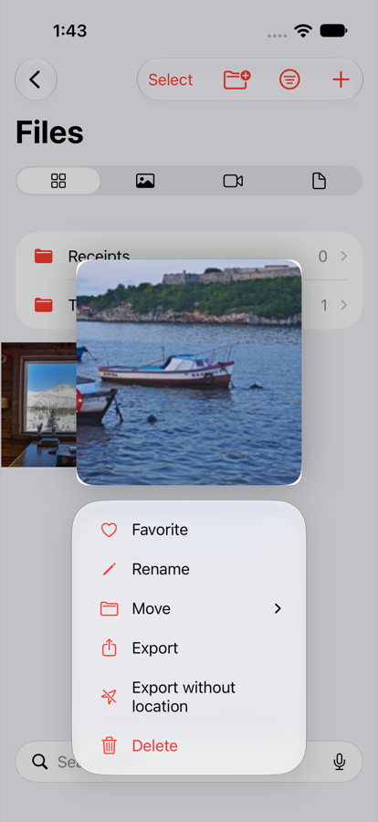 |

**Favorite** stars the photo. **Rename** changes its name. **Move** puts it in Files or in a folder such as Trip, Coast, or Mountains. That is separate from the Move button used when adding a file. **Export** shares a copy, and that copy leaves the vault. **Export without location** shares a photo copy with the location removed. The saved photo keeps its location. **Delete** moves it to Recently Deleted.

The gear inside Hidden Folders opens Private Settings. The page continues below the first screen.

**Welcome** replays the introduction.

**Lock when idle** is Never, 1 minute, 5 minutes, or 15 minutes. Never leaves this area open while NoteLy is on screen. Leaving the app, or tapping Lock, still locks it.

**Ask again for risky actions** is Always ask, Within 30 seconds, or Within 1 minute. Export, emptying Recently Deleted, permanent delete, and deleting a folder can skip the next ask during that window. Changing the passcode, Face ID, backup, or deleting everything always asks.

**Favorites** is Manual, Most Used, or Both. Manual shows starred items. Most Used ranks what you keep open. Both puts stars first. Clear usage history forgets that ranking.

| Welcome, lock, and favorites | Face ID, phrase, and second phrase |
| --- | --- |
| 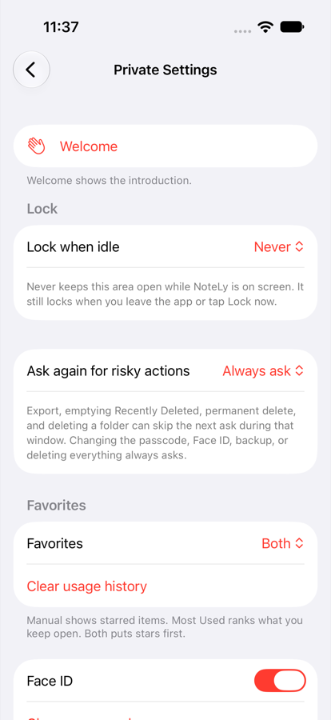 | 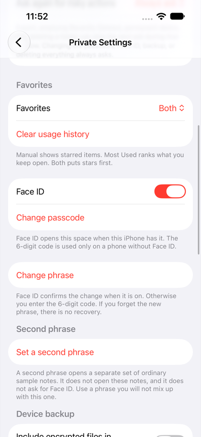 |

**Face ID** opens this space when this iPhone has it. The 6-digit code is used only on a phone without Face ID.

**Change passcode** asks Face ID first. When Face ID is off, it asks for the 6-digit code, then the current code and the new one.

**Change phrase** asks Face ID when it is on, otherwise the 6-digit code. There is no recovery if the new phrase is forgotten. The screen below has an example typed in so the fields are not empty. It is not a phrase saved on a phone.

| New phrase |
| --- |
| 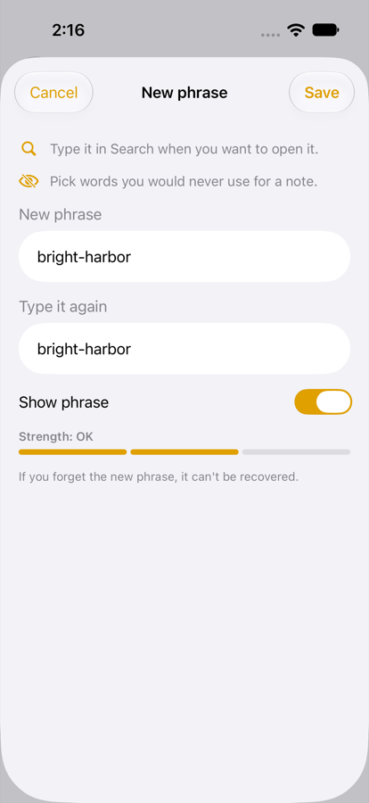 |

**Set a second phrase** opens a separate set of ordinary sample notes. It does not open these notes, and it does not ask for Face ID. Use a phrase you will not mix up with this one.

**Include encrypted files in device backup** is off until you turn it on. Encrypted notes and files then go into an iPhone backup. The key stays on this iPhone, so the Files app and a backup alone cannot open them. Export is how you move them.

**Erase after repeated failures** is off until you turn it on. The stepper runs from 3 to 10 and starts at 5. That many failed Face ID or passcode attempts in a row permanently delete the private notes. Cancelled prompts do not count. Nothing extra is shown when it happens.

| Backup and panic erase | Move, delete, and start over |
| --- | --- |
| 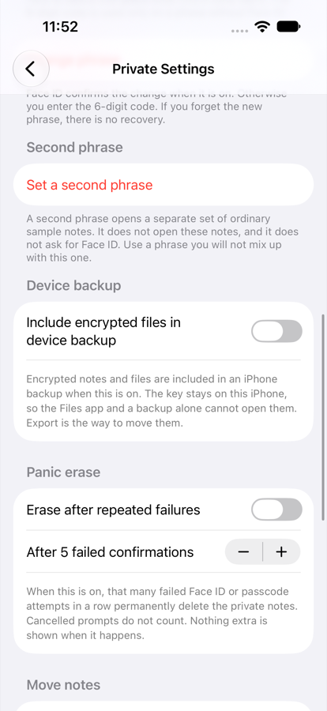 | 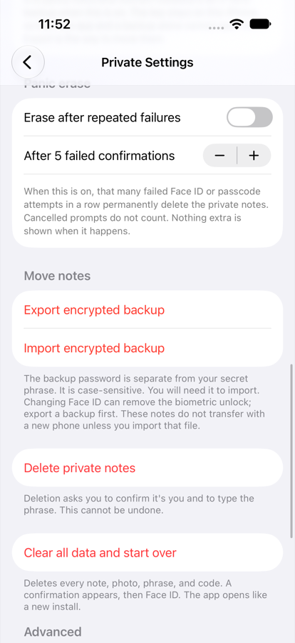 |

**Export encrypted backup** and **Import encrypted backup** use a backup password that is separate from the secret phrase. The password is case-sensitive, and you need it to import. These notes do not move to a new phone unless you import that file. Export a backup before changing Face ID, because a Face ID change can remove the biometric unlock.

**Delete private notes** asks you to confirm it's you and to type the phrase. This cannot be undone.

**Clear all data and start over** deletes every note, photo, phrase, and code. A confirmation appears, then Face ID. The app opens like a new install.

**Face ID Diagnostics** shows whether Face ID or Touch ID can be used on this phone, and the last error code if it cannot.

**Version** is the app version.

| Diagnostics and version |
| --- |
| 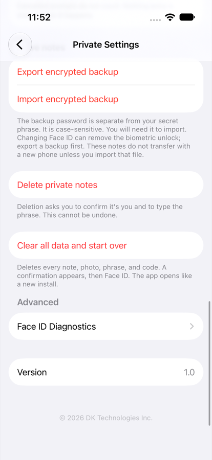 |

### Dark theme

NoteLy follows the iPhone appearance. Dark mode keeps the same layout. Folder names, note titles, and counts stay white or gray, so a row is easy to read. Yellow is only the notes accent: folder icons, dates, and buttons. The hidden space stays red on the icons and controls, with white names. Search and the new-note button use a raised gray field, so they stay visible on the black page. A note saved in light mode still shows its text when the phone is dark.

| Folders | Notes |
| --- | --- |
| 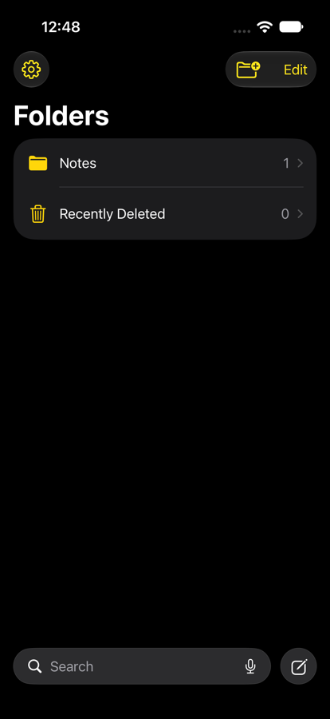 | 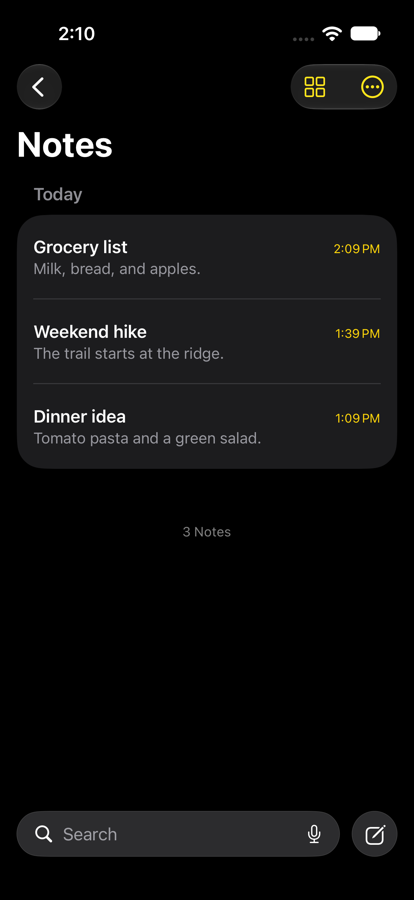 |

| Hidden Folders | Files |
| --- | --- |
| 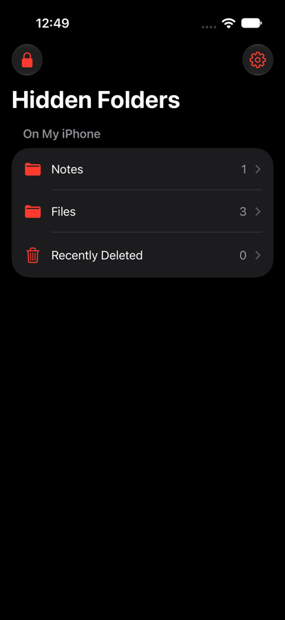 | 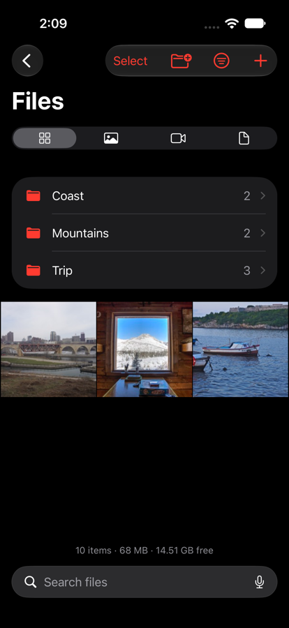 |

## Requirements

- Xcode 16 or newer
- iOS 17.0 or newer
- A device passcode before the private vault can be turned on
- Face ID or Touch ID is used when it is enrolled. The device passcode is the fallback
- No third-party packages

## Run

1. Open `NoteLy.xcodeproj`.
2. For a physical device, select your team under Signing & Capabilities. Simulator builds do not require a team.
3. Run the NoteLy scheme.

Unit tests and UI tests are in the shared scheme:

```bash
xcodebuild -project NoteLy.xcodeproj -scheme NoteLy \
  -destination 'platform=iOS Simulator,name=iPhone 16' \
  test
```

Use an installed simulator name if `iPhone 16` is not available.

## How the vault opens

1. Finish onboarding, or open Settings → Private Vault, and choose a phrase of 8 to 64 characters. Common words, repeated characters, and simple sequences are rejected.
2. Confirm with Face ID, Touch ID, or the device passcode. The system prompt says "Unlock your notes".
3. Later, tap Search, type the phrase, and press Return.
4. If it matches, the same prompt appears. If you confirm, the private note list opens and the search field is cleared.
5. Any other phrase is a normal search. A failed or cancelled prompt returns to the notes list with no vault-specific error.

The phrase is trimmed and lowercased with the POSIX locale before it is hashed, so ` My Phrase ` and `my phrase` match. Capital letters do not matter. The backup password is different: it is case-sensitive and is not stored.

## Architecture

MVVM. Views stay in `NoteLy/Views`, view models in `NoteLy/ViewModels`, and services behind protocols so tests can substitute the keychain.

| Piece | Role |
| --- | --- |
| SwiftData `Note` | Everyday notes |
| `VaultNote` | Codable private note, encrypted before it touches disk |
| `CryptoService` | AES-GCM and PBKDF2-HMAC-SHA256 |
| `KeychainService` | Salted phrase hashes and the vault key |
| `SecretPhraseService` | Normalize, stretch, constant-time compare |
| `BiometricService` | `LAContext` with `.deviceOwnerAuthentication` |
| `VaultStore` | One ciphertext file per private note |
| `VaultFileStore` | Encrypted photos, videos, and files (`NLF2` chunks, HKDF subkeys) |
| `AppState` | Lock state, scene phase, search submit |

Public notes live in SwiftData. Private notes are JSON, sealed with AES-GCM, and written under Application Support. Disk names are UUIDs. Photo bytes are a separate sealed file. Decrypted notes and the key are kept in memory and dropped on lock.

## Security notes

- The phrase is never written to UserDefaults, source, logs, or the keyboard dictionary. Search autocorrect, autocapitalization, and spellcheck are off. Search text is not persisted.
- The stored verifier is a random 16-byte salt plus PBKDF2-HMAC-SHA256 (120,000 iterations). Comparison walks every byte. The iteration count is stored with the hash so a later change does not break existing phrases.
- The phrase is checked only when Search is submitted, not on each keystroke.
- The vault key is a random 256-bit `SymmetricKey`. It is stored with `kSecAttrAccessibleWhenPasscodeSetThisDeviceOnly` and access control `.biometryCurrentSet OR .devicePasscode`, and it is not synchronizable. Each AES-GCM seal uses a new nonce. Notes are chunked at 256 KB. Photos, videos, and other files use 1 MB chunks in the `NLF2` format, with the chunk index and file id as authenticated data. Index, file, and thumbnail keys are HKDF subkeys of the vault key.
- Inside the vault, Files imports from Photos, the document picker, or the camera. Ciphertext lives under Application Support with UUID names, file protection, and backup exclusion. Decrypted bytes are memory or short-lived temp files deleted on dismiss, lock, and launch. Video playback prefers a resource loader so the file is not written in plaintext; a temp file is the fallback and is deleted with the other temps.
- Exported files leave the vault. "Export without location" rewrites image GPS metadata only for that copy. Removing an import from Photos uses the system delete confirmation and leaves the item in Recently Deleted.
- Reading the key reuses the `LAContext` that just succeeded, for about 10 seconds, so the system prompt is not shown twice.
- Vault files are excluded from iCloud and Finder backup unless you opt in. The key still does not leave the device, so a backup of the files alone cannot be opened elsewhere. Use Export for a real move.
- Lock drops the key and the decrypted notes when the app backgrounds, when the inactivity timer fires (default 60 seconds; also 30 seconds, 5 minutes, or immediately), or when you tap Lock. "Immediately" locks as soon as the app resigns active, except during the system prompt.
- A privacy cover is shown while the private area is open and the scene is inactive, or while the screen is captured (recording or mirroring). Logs go through `os.Logger` and do not include phrases, note text, or keys.
- Nothing is donated to Spotlight, Siri, or App Shortcuts.
- Five failed biometric attempts in 10 minutes start a silent 5-minute cooldown. During it, submitting the phrase behaves like a normal search.
- Optional panic erase, off by default, deletes the vault after N failed confirmations in a row. Cancelled prompts do not count.
- A second phrase can open a separate decoy list seeded with ordinary sample notes. It does not use the vault key and does not prompt for Face ID.
- A basic jailbreak warning is shown only inside private settings. It is not a security boundary.

Face ID usage string: `Used to securely unlock your private notes.`

`ITSAppUsesNonExemptEncryption` is false because encryption is the operating system's CryptoKit and CommonCrypto. Confirm that answer in App Store Connect's export questionnaire.

## Tests

- `CryptoServiceTests` and `VaultFileCryptoTests`: note and file round trips, wrong key, tampering, HKDF separation, a 50 MB stream, and orphan cleanup.
- `SecretPhraseServiceTests`: normalization, mismatch, length limits, plaintext not stored, phrase change, decoy, and the silent attempt limiter.
- `VaultStoreTests`: CRUD, wrong key, ciphertext does not contain the note text, attachments, backup exclusion, and encrypted backup import with a wrong password.
- `NotesSearchUITests`: a normal search filters notes; a wrong phrase does not open the vault; a phrase supplied by the test opens it when the debug biometric stub succeeds.

The UI-test hook is compiled only in Debug, and only when the process is launched with `-ui-testing`. Release builds do not include it. The test phrase is not in the app target.

## App Review

Paste `APP_REVIEW_NOTES.md` into App Store Connect. Host `PRIVACY.md` and put that URL in the privacy policy field. The nutrition label can be Data Not Collected: notes, phrases, and keys stay on device, and the app has no account and no network client.

Suggested description line: "NoteLy is a notes app with an optional private vault. You choose a secret phrase during setup. Typing that phrase into Search and confirming with Face ID or your passcode opens encrypted notes that stay on your device."
